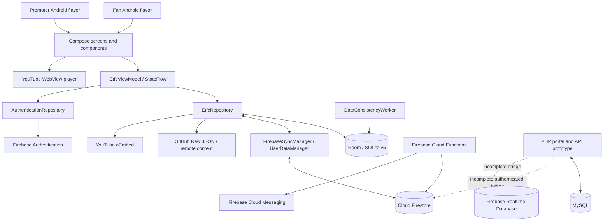

# ETFC Stream

An Android fan experience and promoter workspace for the **Ethiopian Top Fight Championship**: discover fight cards, browse athletes, watch YouTube replays, manage event content, and explore a pay-per-view arena experience.

**Status:** development prototype, prepared for GitHub source migration on **21 October 2026**. The repository includes substantial UI and data infrastructure, alongside simulated commerce, live broadcast, and download flows. It is not a production payment or broadcast service. See [implementation status](#implementation-status) and the [roadmap](docs/ROADMAP.md) before planning a release.

## Contents

- [App experience](#app-experience)
- [Implementation status](#implementation-status)
- [System architecture](#system-architecture)
- [Technology and build variants](#technology-and-build-variants)
- [Repository layout](#repository-layout)
- [Quick start](#quick-start)
- [Configuration and credentials](#configuration-and-credentials)
- [Build, test and CI](#build-test-and-ci)
- [Backend services](#backend-services)
- [Content management](#content-management)
- [Progress tracking](#progress-tracking)
- [Documentation](#documentation)
- [Contributing and ownership](#contributing-and-ownership)

## App experience

The fan app uses a dark Material 3 interface with gold accents, red and blue fighter corners, featured event banners, and fight posters. Its primary navigation is Home, Live Arena, Fight Card, PPV Passes, Fighters, and Settings.

| Area | What the source provides |
| --- | --- |
| Home | Featured posters, event information, news, and a previous-fight video vault |
| Fight cards | Upcoming and past bouts, fighter comparison, local predictions and favorites |
| Fighters | Division browsing, profiles, seeded stats, fight history and tale-of-the-tape views |
| Replays | WebView-backed YouTube embeds, playlist support, URL parsing, thumbnails and oEmbed metadata |
| Live arena | Broadcast interface, quality/camera controls, stats, chat and moderation components |
| PPV passes | Provider selection, purchase dialog, pass wallet and local entitlement state |
| Account | Firebase email/password and Google credential flows, profile screens and reset requests |
| Promoter workspace | Content editors, fighter and match management, announcements, image picking, team and athlete registration screens |

The `admin` flavor is branded **ETFC Promoter CRM**. A separate application ID allows it to coexist with the fan app. Flavor selection controls UI behavior; it does not confer server privileges.

## Implementation status

"Implemented" below means source exists; it does not imply a completed device acceptance test or a deployed service.

| Capability | State | Practical limit |
| --- | --- | --- |
| Compose screens and navigation | Implemented | Manual tab routing in one activity; no Navigation Compose graph |
| Room persistence | Implemented | Database v5, 17 entity types; destructive migration fallback |
| Firebase authentication | Implemented | Requires a configured Firebase project and providers |
| Firestore content synchronization | Implemented with integration gaps | Listeners and writes exist; identity and security contracts need alignment |
| YouTube replay playback | Implemented | Uses embeds; internet and YouTube availability are required |
| Athlete registration | UI and Firestore adapter | Collection authorization and privacy policy remain to be designed |
| Live HLS/ABR/multiple cameras | Prototype | Player controls and telemetry are UI state, not a verified streaming pipeline |
| PPV checkout | Simulation / backend scaffolding | Android grants local passes after a delay; provider checkout initialization is incomplete |
| Payment webhooks | Disabled safely | Return HTTP 503 until authenticated provider verification exists |
| Offline encrypted video | Simulation | Download progress and file paths are simulated; no verified media download/encryption engine |
| RBAC | UI plus restrictive rules baseline | Server claims are authoritative; client email checks still need replacement |
| Push notifications | Partial | Match-update function exists; Android topic subscription/receipt is not wired end to end |
| Tests | Limited | RBAC/resource tests, package smoke test, PHP security smoke tests and CI configuration |

Seeded news, event dates, venues, fighter stats, prices, crowd counts and network metrics are demonstration content. Confirm them independently before publishing an event or charging a customer.

## System architecture



The Android app is an MVVM-style single-module application. `MainActivity` creates the Compose shell. `EtfcViewModel` owns screen state and constructs repositories and sync services. Room stores local content and user-facing state; Firestore adapters synchronize selected collections. Retrofit/OkHttp retrieve remote content and YouTube metadata. WorkManager repairs references between fighter records and related content.

This is not a fully separated Clean Architecture implementation: the ViewModel and repository contain significant orchestration, seeded content, and platform dependencies. PHP/MySQL is a parallel backend prototype; the Android app does not currently use its PPV endpoints as its payment authority. [Detailed architecture and trust boundaries](docs/ARCHITECTURE.md).

## Technology and build variants

Versions below come from the checked-in configuration. The [version catalog](gradle/libs.versions.toml) is the source of truth.

| Component | Configuration |
| --- | --- |
| Language / UI | Kotlin 2.2.10, Jetpack Compose, Material 3 |
| Android Gradle plugin / wrapper | AGP 9.4.0 / Gradle 9.6.0 |
| Android | Minimum API 24; target API 36; compile API 36.1 |
| App release metadata | `versionName=1.0.002`, `versionCode=2` |
| Local database | Room 2.7.0, schema version 5 |
| Network / images | Retrofit 2.12.0, Moshi 1.15.2, OkHttp 4.10.0, Coil 2.7.0 |
| Firebase | BOM 34.17.0, Authentication, Firestore, Storage and App Check dependencies |
| Background work | WorkManager 2.10.0 |
| Functions | TypeScript, Firebase Functions v1 API, Node 20 runtime declaration |
| Web backend | PHP, PDO MySQL and cURL; MySQL schema included |

| Flavor | Application ID | App label |
| --- | --- | --- |
| `user` | `com.aistudio.etfcstream.vfkqw` | ETFC Stream |
| `admin` | `com.aistudio.etfcstream.admin` | ETFC Promoter CRM |

The source namespace remains `com.example`; changing it is a separate refactor. Debug builds use the Android tooling's generated debug key. Release signing is supplied through environment variables and is never committed.

## Repository layout

```text
app/
  build.gradle.kts                 Android variants, signing and dependencies
  google-services.example.json    Synthetic build-only Firebase configuration
  src/main/java/com/example/
    MainActivity.kt               App shell, navigation and image loader
    data/local/                   Room database, DAO and entities
    data/models/                  Auth, bout, fighter, content and athlete models
    data/remote/                  Firebase, HTTP, YouTube and JSON adapters
    data/repository/              Content, account and local feature operations
    data/security/                Legacy local hash/token helpers
    ui/components/                Player, posters, forms, dialogs and guards
    ui/screens/                   Fan and promoter screens
    ui/theme/                     Colors, typography and Material theme
    ui/viewmodel/                 StateFlow app state and actions
    notifications/               Android notification helper
    util/                        Local image storage and consistency worker
  src/main/res/                   Required images, icons and Android resources
  src/user/, src/admin/           Flavor resources
  src/test/, src/androidTest/     Focused local and instrumentation tests
cpanel_backend/                   PHP portal, API, config and SQL schema
functions/                        Firebase TypeScript functions and lockfile
gradle/                           Version catalog and checked-in Gradle wrapper
docs/                             Architecture, setup, API, review and roadmap
tests/php/                        Backend security smoke tests
.github/                          CI, issue templates and PR template
firebase.json                     Firebase deployment component configuration
firestore.rules                   Firestore authorization baseline
firestore.indexes.json            Empty explicit index baseline
storage.rules                     Deny-all Storage baseline
```

## Quick start

1. Clone this repository and open the root directory in Android Studio.
2. Configure JDK 21 and install Android SDK platform 36.1 plus Build Tools 36.0.0. The Java source/target setting of 11 in the app is distinct from the JDK used to run Gradle.
3. Let Android Studio create `local.properties` pointing at your SDK.
4. Register both application IDs in your own Firebase project. Download the Android configuration to `app/google-services.json`. Enable the authentication providers you intend to use and register your local debug certificate fingerprints for Google sign-in.
5. For compilation only, you can copy `app/google-services.example.json` to `app/google-services.json`. Its synthetic values do not connect to a working Firebase project, and it is not a functional offline/demo mode.
6. Select `userDebug` or `adminDebug` in Build Variants and build/run.

```powershell
# Windows, from the repository root
.\gradlew.bat :app:assembleUserDebug :app:assembleAdminDebug
```

```bash
# macOS / Linux
./gradlew :app:assembleUserDebug :app:assembleAdminDebug
```

APKs appear under `app/build/outputs/apk/user/debug/` and `app/build/outputs/apk/admin/debug/`. The wrapper pins its distribution checksum. No globally installed Gradle is needed. [Full development setup](docs/SETUP.md).

## Configuration and credentials

- `app/google-services.json`, `.env`, `local.properties`, signing keys, service accounts, editor state, generated builds and dependencies are ignored.
- Android Firebase configuration is client configuration; this repository deliberately supplies only synthetic example values.
- PHP settings come from process environment variables documented in `cpanel_backend/.env.example`. Copying that file alone does not load it into PHP.
- Release signing uses `KEYSTORE_PATH`, `STORE_PASSWORD`, and `KEY_PASSWORD`; the configured key alias is `upload`.
- API secrets, database passwords, payment signing keys and service-account credentials must remain server-side. BuildConfig values and APK contents are readable by app users.
- Historical embedded credentials were removed during migration. Rotate the old database password and signing/webhook secrets before reusing the original hosted environment. See [security guidance](SECURITY.md).

## Build, test and CI

```powershell
.\gradlew.bat :app:testUserDebugUnitTest :app:testAdminDebugUnitTest
.\gradlew.bat :app:lintUserDebug :app:lintAdminDebug
# With an emulator/device connected:
.\gradlew.bat :app:connectedUserDebugAndroidTest

Set-Location functions
npm ci
npm run lint
npm run build
Set-Location ..
php tests/php/security_smoke.php
```

On macOS/Linux replace `.\gradlew.bat` with `./gradlew`. PHP syntax validation is run for every `.php` file in CI. The security smoke test verifies callbacks refuse payment grants and configuration has no default privileged credentials.

[GitHub Actions](.github/workflows/ci.yml) runs Android builds, focused unit tests and lint for both flavors, plus TypeScript lint/build and PHP syntax/security checks. It uses synthetic Firebase configuration and does not deploy or charge payments. Device tests, Firestore emulator tests, payment sandbox tests, load testing and production acceptance remain separate release gates. Check [review evidence](docs/REVIEW.md) for the actual migration validation results.

## Backend services

### Firebase

`functions/src/index.ts` exports a match-status notification trigger, an invitation-based admin claim function, and a disabled payment webhook. Configure a separate development Firebase project and use emulators for further backend development. The function runtime declaration is Node 20; confirm deployment runtime availability before deploying.

The checked-in Firestore rules require an `admin` custom claim for privileged writes. User profiles are scoped to full Firebase UIDs and protected against self-editing roles and entitlements. Storage denies access until a deliberate media policy is implemented. **The existing Android client still uses shortened/prefixed user IDs and email-based role assumptions. Those contracts must be migrated before these rules are deployed to an existing project.** The restrictive baseline intentionally rejects incompatible operations.

### PHP / MySQL

`cpanel_backend` contains a landing page, web admin, event/stream endpoints, PPV order scaffolding and SQL bootstrap data. No database is bundled. Payment callbacks return HTTP 503; order initiation does not yet create real provider checkout sessions. The Firebase REST bridge lacks authenticated server credentials and an agreed identity mapping.

Read [backend setup](docs/BACKEND.md) and [API reference](docs/API.md) for paths, request fields and limitations. This repository migration does not deploy any backend or change a hosted database.

## Content management

The promoter UI can edit local and Firestore-backed content, pick images, and import/export `ETFC_CONTENT_SYNC_V1` JSON. The export includes `heroSlides`, `previousVideos`, `newsArticles`, and `fighters`; it is not a backup of accounts, purchases, athlete applications or the full match database. Local `file://` image paths are device-specific and must be replaced by portable URLs for shared content.

GitHub Raw JSON import reads a supplied raw content URL. It does not write to GitHub, deploy this app, or make GitHub a trusted payment/account backend. Only publish reviewed public event content in a public content file.

## Progress tracking

The [roadmap](docs/ROADMAP.md) tracks migration, security, streaming, commerce, data consistency and release readiness using task IDs, priorities and acceptance criteria. It separates completed migration work from planned product work.

Use the repository issue templates for defects and scoped features. Reference a roadmap ID in each issue/PR, include verification evidence, and update the checklist when acceptance criteria are met. Avoid percentage-complete estimates until scope and device/backend verification are defined.

## Documentation

| Document | Purpose |
| --- | --- |
| [Architecture](docs/ARCHITECTURE.md) | Modules, data flows, persistence and trust boundaries |
| [Setup](docs/SETUP.md) | Android, functions, signing and troubleshooting |
| [Backend](docs/BACKEND.md) | PHP hosting layout, Firebase setup and deployment gates |
| [API](docs/API.md) | PHP endpoints, Firebase collections and function contracts |
| [Roadmap](docs/ROADMAP.md) | Progress checklist and release acceptance criteria |
| [Review](docs/REVIEW.md) | Findings, cleanup decisions and validation evidence |
| [Security](SECURITY.md) | Credential handling and reporting |
| [Contributing](CONTRIBUTING.md) | Change workflow and review expectations |
| [Changelog](CHANGELOG.md) | Repository preparation and subsequent changes |

## Contributing and ownership

Read [CONTRIBUTING.md](CONTRIBUTING.md), start from `main`, and submit small changes with clear validation. Do not commit credentials, real customer/payment records, signing keys, generated APKs or local build caches.

The existing GitHub repository remains **private** at the owner's instruction. Its current tree is cleaned; historical credential-bearing commits remain private and must be reviewed before changing visibility. No open-source license has been selected by the owner. ETFC branding, fighter photographs, posters and third-party media retain their respective ownership; confirm distribution rights before using them outside this project. Dependencies retain their own licenses.
